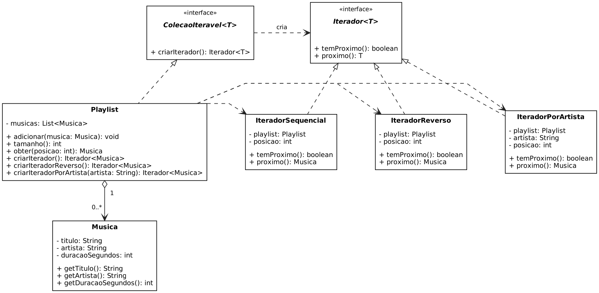

# Padrão de Projeto: Iterator

Trabalho da disciplina Arquitetura e Projeto de Software — implementação do padrão de projeto comportamental Iterator.

## O que o padrão resolve

O Iterator fornece uma forma de percorrer os elementos de uma coleção sem expor sua representação interna. O código que consome a coleção não precisa saber se ela usa lista, vetor ou outra estrutura, nem como o percurso é feito: ele só pergunta ao iterador se existe um próximo elemento e pede esse elemento. Além disso, a mesma coleção pode oferecer diferentes formas de percurso, cada uma em um iterador próprio, e vários iteradores podem andar sobre a mesma coleção ao mesmo tempo, cada um com a sua posição.

## Aplicação escolhida

Uma playlist de músicas (`Playlist`) que guarda objetos `Musica` e oferece três formas de percorrê-los:

- `IteradorSequencial`: da primeira para a última música;
- `IteradorReverso`: da última para a primeira;
- `IteradorPorArtista`: apenas as músicas de um artista informado.

O código cliente (por exemplo, imprimir a playlist ou somar a duração) trabalha somente com a interface `Iterador` e funciona com qualquer um dos três percursos, sem conhecer a classe concreta.

## Estrutura do projeto

```
iterator-pattern/
├── src/
│   ├── main/java/com/univassouras/iterator/
│   │   ├── Iterador.java
│   │   ├── ColecaoIteravel.java
│   │   ├── Musica.java
│   │   ├── Playlist.java
│   │   ├── IteradorSequencial.java
│   │   ├── IteradorReverso.java
│   │   ├── IteradorPorArtista.java
│   │   └── Main.java
│   └── test/java/com/univassouras/iterator/
│       └── PlaylistTest.java
├── diagrama/
│   └── diagrama-classes-iterator.png
├── pom.xml
└── README.md
```

## Papéis do padrão nesta implementação

| Papel no padrão              | Classe neste projeto                                            |
|-------------------------------|-------------------------------------------------------------------|
| Iterador (Iterator)           | `Iterador`                                                      |
| Iteradores concretos          | `IteradorSequencial`, `IteradorReverso`, `IteradorPorArtista`   |
| Coleção (Aggregate)           | `ColecaoIteravel`                                               |
| Coleção concreta              | `Playlist`                                                      |
| Elemento percorrido           | `Musica`                                                        |

## Como executar

Pré-requisitos: JDK 17+ e Maven (ou usar o Maven embutido do IntelliJ).

```bash
mvn compile exec:java -Dexec.mainClass="com.univassouras.iterator.Main"
```

A saída mostra a mesma playlist percorrida em ordem normal, em ordem reversa e filtrada por artista, e a soma da duração calculada por um método que recebe apenas a interface `Iterador`.

## Como rodar os testes

```bash
mvn test
```

Os testes cobrem:
- percurso sequencial, reverso e por artista, com a ordem esperada em cada caso;
- filtro por artista sem diferenciar maiúsculas de minúsculas e sem resultados;
- exceção ao pedir o próximo elemento depois do fim da coleção;
- playlist vazia em todos os iteradores;
- dois iteradores independentes sobre a mesma playlist;
- código cliente funcionando com qualquer iterador através da interface;
- `Playlist` usada como `ColecaoIteravel`.

## Diagrama de classes



## Autor

Trabalho individual — disciplina Arquitetura e Projeto de Software.
